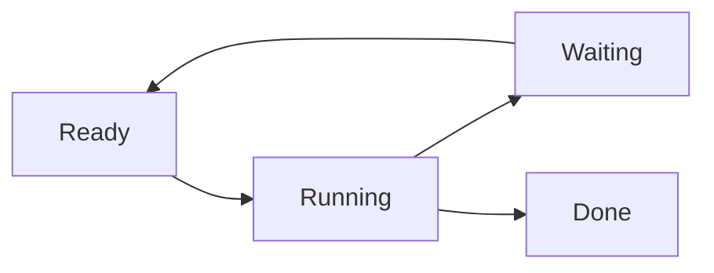

## Specification (resolved)

### 1. Task states



* `running`: only count matters for scheduling (`runningCount < nbrWorkers`). A `running` set is kept for debug only.
* `waiting`: blocked on `Semaphore.acquire()` or `TaskIO.require()`. Kept as an unordered `Set` for debug only — waiting tasks run in parallel and leave spontaneously.
* `ready`: unblocked, waiting for a `running` slot. Stored as FIFO queue of `activate` continuations. Order matches scheduling order.
* `nbrWorkers` replaces `concurrent`. Infinite (`Infinity`) is allowed but then streams are forbidden — batches only. Hence the runner exposes `addBatch()` and `addStream()` separately so stream admission can be refused in infinite mode.
* Goal of the priority is to keep the minimum started tasks while keeping `runningCount` at target.

### 2. Activate wrapping

```ts
// conceptual
waitForSync = R(Ts); // R wraps the task-sync promise Ts
```

* Lifecycle: every started task enters the `running` set. When it blocks on a task-sync, it leaves `running` for the `waiting` set. The waiter awaits a wrapped promise `R(Ts)` where `Ts` is the underlying semaphore/TaskIO promise.
* When `Ts` resolves (with value `v`), the task mutates `waiting` → `ready` and its `resolve(v)` continuation is appended to the `ready` FIFO.
* `ensureWorkers()` consumes the `ready` FIFO when a `running` slot frees (`runningCount < nbrWorkers`); re-activated tasks re-enter `running`.
* A task moving into `ready` triggers `ensureWorkers()` — with no stream pools involved, `nbrWorkers` may be infinite so `ready` arrivals must pump the loop themselves.
* `acquire(a, b)` collapses to a single `SemaphoreUnit.acquire` — no multi-primitive partial-acquisition bookkeeping beyond what the unit already does.
* `waiting` is an unordered set (debug only); `ready` is a FIFO (scheduling order).

### 3. Pools

* `batches`: FIFO queue. Each batch provides a `task | batch` pool plus named sync declarations (semaphores / TaskIO specs). Batches may yield batches (nesting allowed). Pools never produce streams — only `task | batch`.
* `streams`: rotating queue. `shift` → pull one `task | batch` → `push` back if not ended; ended streams are dropped. Streams are "infinite" only in the sense we don't expect to finish them — any iterator reporting `done` ends the stream.
* Admission: runner exposes `addBatch()` and `addStream()` separately. When `nbrWorkers` is infinite, streams are forbidden (batches only).
* `ensureWorkers()` priority on a free `running` slot:
  1. shift `ready` FIFO and resolve its `activate`
  2. shift `batches` FIFO
  3. rotate `streams`
* `activeStreams` (rotation order) must be listable in order.

### 4. Display API

Runner exposes list/tree builders with signature:

```ts
list(options: { running: boolean; ready: boolean; waiting: boolean }): Snapshot[]
```

Same flags for tree mode. `running`/`waiting` lists are debug-only; `ready` order must match scheduling FIFO.

### 5. Batch and sync metadata

* Batch: `{ pool: Iterable<Task|Batch>, syncs: NamedSyncs, poolEmpty: boolean }` where `NamedSyncs = { [name]: Semaphore | TaskIO }`.
* A batch may additionally provide execution units: one semaphore-unit and one TaskIO-unit (two optional objects, which in general are the same `localExecutionUnit` result). Providing TaskIOs requires providing a TaskIO-unit; providing semaphores requires providing a semaphore-unit. Units back the named syncs the batch declares.
* `poolEmpty` is written by the pool iterator (first `done=true` observed), not by the batch explicitly. While `poolEmpty=false`, render `...` after the batch's active tasks.
* Sync objects gain `icon?: string` with per-kind defaults (one default for semaphores, one for TaskIO). While a task waits, `status.icon` shows the waited sync's icon (explicit, else kind default). `task-sync` serializes waits so at most one icon is displayed at a time.
* The old `waiting-input` state was the embryo of this system and is overridden by it: the single hardcoded TaskIO-wait icon becomes the overridable per-kind TaskIO default icon.
* Minimal in-memory structures only: keep just enough to rebuild list/tree visuals, no parallel debug copies that could go inconsistent.

### 6. Hierarchy syncs (group-declared)

* `ATaskGroup.launched()` currently builds `arg = { status, group: this }`. It will also carry the sync hierarchy head: `arg = { status, group, syncs }`, where `syncs` is the head of the `Object.create` chain cumulating declarations from root down to this group.
* Task-syncs are **named** per task/group: each level declares a record of `{ [name]: Semaphore | TaskIO }` (semaphores and TaskIOs live in the same named record, distinguished by kind).
* Cumulation is a live prototype chain: `Object.create(parentSyncs)` with child names assigned over it, from root down to task. Later parent mutations are visible to already-launched tasks through the chain. On name collision the child entry shadows the parent entry.
* A child may only replace (shadow) a parent entry — attempting to narrow/widen a parent semaphore's capacity (`freeInstances`) raises an error.
* Group syncs are never auto-acquired and never block before the body starts: a task only blocks on an explicit programmatic `await` (`acquire`/`require`). The cumulated record is registered in the task space before the body runs so those awaits resolve names against the full hierarchy with the single existing ordering/deadlock logic.
* While a task waits (on a group-declared or task-declared sync alike) it sits in the `waiting` set and is not in the `running` set: `running` is exactly the set of currently-running tasks, with no slot reservation for non-running tasks.

### 7. In-memory structures (minimal)

* Each group keeps a list of its direct sub-statuses (`task` / `batch` entries) — the tree is rebuilt from these, replacing `ATaskGroup.active`.
* The runner keeps: a `ready` array (FIFO of continuations), an array of app-provided pools (streams + batches in admission order), a `waiting` set, a `running` set — replacing `TasksRunner.workers`. List/tree visuals derive from exactly these, no duplicate copies.